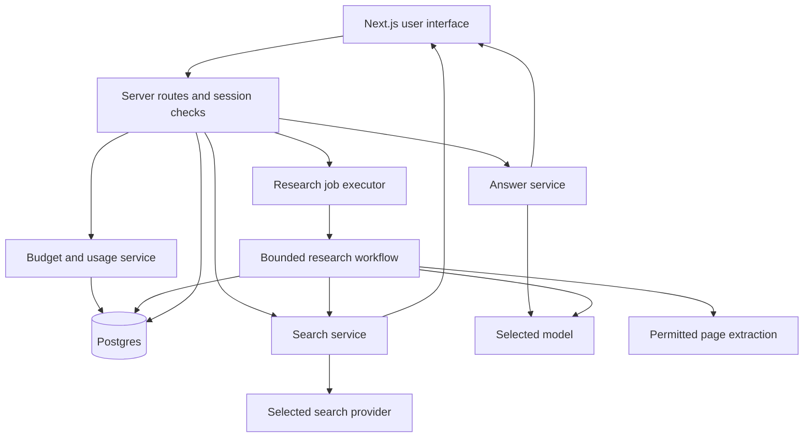
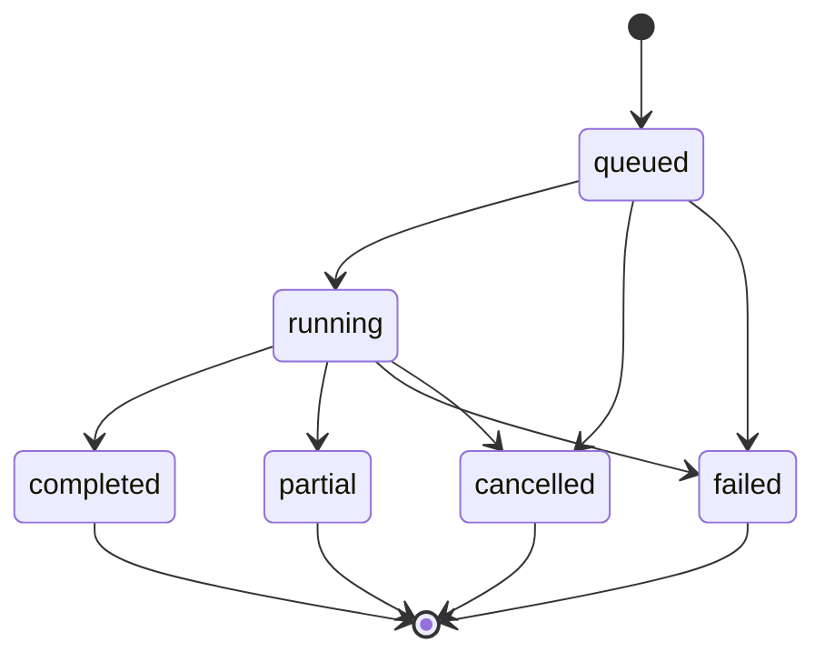

# JoySearch architecture plan

Initial plan: 11 November 2026. Updated 14 November 2026 for the focused personal-project milestone. Product constraints: [design brief](design-brief.md).

## Implemented search, answers, and hosted spending controls

The current application has server-side search and optional cited answers. Search returns links first, plus a signed receipt containing the bounded evidence, query, ten-minute expiry, and an HMAC-derived binding to an HTTP-only session cookie. The receipt authenticates provenance; it does not encrypt the already-visible evidence or prove factual truth. The answer route rejects altered, expired, or cross-session receipts before paid work.

The answer path uses a bounded two-stage workflow through AI Gateway: a fixed GPT-5 mini router with minimal reasoning, followed when needed by a GPT-4.1 mini writer at temperature 0. A structured intent call resolves entity and measure separately. Server routing returns clarification when either remains unresolved, builds navigation claims from a selected server-known source title, or returns an evidence gap. Only a factual answer invokes the writer, which cannot override that route. Schema validity does not prove correct intent classification; the [owned-evidence evaluation](../milestone-2/answer-evaluation.md) grades that behavior and semantic support separately. The [final revision](../milestone-2/revision-results.md) passes its declared gates on twelve fresh owned cases, with 17/17 facets and supported claim blocks. This limited assistant-reviewed result does not establish general web accuracy.

Both stages see the same prepared passages. Packing includes both system prompts and router-schema overhead. The router supplies only control-flow fields; the writer receives no generated checklist or intermediate content. Each stage has a 4,000-input-token bound; the router permits 300 output tokens and the writer 600, for at most 8,000 input and 900 output tokens including reasoning. One shared 15-second deadline covers both calls. There are no tools, extra searches, retries, or model fallback. The current pair of rate cards gives a $0.00416 maximum token cost, covered by a $0.01 reservation per logical operation. The evaluator verifies both models' eligibility and rates before dispatch and freezes each model ID, settings and rates. Stage usage is attributed to its actual model and estimated cost is summed using each stage's rate card; completed usage, attempted-call counts, and provider IDs remain accounted for if later work fails.

The writer streams complete claim records only after citation-ID validation. Completion follows normal provider termination and ledger settlement. Source links come from the server map. The browser discards partial answers after truncation, invalid output, cancellation, or a new search; existing search results remain usable.

For local development, a durable file ledger serializes paid operations under the original $5 experiment cap. The evaluator spaces logical requests at least 30 seconds apart and caps each campaign at 12 cases / 24 model calls, also enforcing its $0.30 allocation. A fixed $1.000 hosted allocation is reserved in this ledger from the remaining $1.078, leaving $0.078 locally. This partition prevents local and hosted execution from independently consuming the same remaining budget.

Hosted accounting uses a separate Neon database on the existing Free plan. A SQL function locks the permanent budget row, checks enablement, global and session allowances, pacing, and duplicate operation IDs, then commits the reservation before paid dispatch. The cap is $1.000; Exa search reserves $0.007, optional Brave search $0.005, and an answer $0.01. The runtime role has only schema usage and execution grants for reservation, settlement, and status functions. It cannot read or update tables directly, reset commitments, or enable the budget. Admin credentials remain outside production. Request code never initializes missing budget state.

Hosted requests require Vercel production, explicit `JOYSEARCH_LIVE_ENABLED=true`, and exact URL/Host/Origin agreement with `https://joysearch.vercel.app`; previews deny paid requests. HMAC-signed sessions expire absolutely after 24 hours, reserve at most $0.05 each, and space searches by 5 seconds and answers by 10 seconds. Search IDs are scoped to a signed session, and answer IDs hash the authenticated receipt. Replays are rejected rather than dispatched again. Invalid receipts, origins, or configuration fail before the budget or provider boundary.

Missing or ambiguous database responses fail closed. Failures, disconnects, and cheaper responses never refund reservations. Settlement persists bounded operational metadata and must complete before the final answer event. Database state persists across releases and has no automatic expiry or allowance reset. The operator SQL kill switch blocks new reservations immediately; existing in-flight work remains reserved. Anonymous session rotation can exhaust the allowance, so the global cap remains authoritative. The cap relies on the verified provider request shapes and prices; a reported search overage is recorded and disables new dispatch rather than being silently ignored.

Public release verification remains pending; the [deployment runbook](../deployment.md) records the target, controls, and release checks. Durable research remains a proposal. The implemented scope is one Next.js app, a small accounting database, at most two bounded model calls per optional answer, and reviewable quality evidence.

```mermaid
sequenceDiagram
    participant U as Browser
    participant S as Search route
    participant P as Search provider
    participant A as Answer route
    participant M as AI Gateway
    U->>S: Search query
    S->>P: Reserve budget; search once
    P-->>S: Results and excerpts
    S-->>U: Links, session cookie, signed evidence receipt
    U->>A: Explicit answer request with receipt
    A->>A: Verify session, signature, expiry; reserve budget
    A->>M: GPT-5 mini: structured intent, minimal reasoning
    M-->>A: Resolved entity/measure, destination and evidence flags
    A->>A: Deterministic routing
    alt Clarification, navigation or insufficient evidence
        A->>A: Prepare routed response without writer
    else Factual answer
        A->>M: GPT-4.1 mini: factual writer, temperature 0, same passages
        M-->>A: Claim records with fixed answer kind
        A-->>U: Validated citation IDs and claims
    end
    A->>A: Settle usage
    A-->>U: Completed answer or controlled error
```

JoySearch remains a single Next.js application. Initial links do not wait for a model. The research path and additional retrieval described below are deferred options, not requirements for completing this personal-project milestone.

## Historical baseline before the search integration

The original migrated application exported a static site. The browser called Wikipedia through `lib/wikipedia.ts`; `components/search-app.tsx` owned request cancellation and stale-response protection. Result links depended on Wikipedia page IDs. There was no application backend, database, or paid provider configuration.

The local search integration removed `output: "export"`, moved provider requests behind server routes, and introduced provider-neutral URLs and evidence. Request-dependent route handlers cannot be delivered by a static export. [Next.js static export documentation](https://nextjs.org/docs/app/guides/static-exports)

The accessible form, responsive layout, and cancellation semantics remain. The [initial failed answer-behavior gate](../milestone-2/results.md) and [subsequent passing confirmation](../milestone-2/revision-results.md) are retained separately. Those frozen quality runs predate the deployment controls; hosted correctness is checked separately through route, session, and database tests.

## Deferred public and research design

The remaining sections preserve the original broader design alternatives for review. Research jobs, persistent provider-derived reports, recurring monthly API budgets, and additional infrastructure are not implemented or newly authorized. The small Postgres accounting boundary described above is implemented; its current $1 lifetime allocation takes precedence over the historical monthly estimates below. Owned fixture demonstrations can remain available without paid requests.

## Components and boundaries



The implemented shared transactional store holds budget reservations and bounded operational metadata. If durable research is later justified, it could also hold research state under a separate data-retention decision. A managed executor would dispatch those jobs; its exact product and price remain open. A job must not depend on continuing work after an HTTP response has ended.

| Boundary | Responsibility |
| --- | --- |
| UI | Query state, separate results/answer/research states, streaming rendering, source inspection, and cancellation |
| Server routes | Validate requests, authenticate the anonymous session, enforce origin and usage policies, and return typed errors |
| Search service | Normalize provider data and return useful results independently of model generation |
| Answer service | Select bounded evidence, generate cited text, and validate citation identifiers |
| Research workflow | Plan a small number of steps, search/read concurrently within limits, and publish supported findings or gaps |
| Usage service | Reserve cost before work, reconcile billed usage, and prevent concurrency from bypassing caps |
| Persistence | Private run state, step outcomes, permitted artifacts, and operational metadata |

The provider contract should expose `search(query, locale, freshnessIntent, limits, signal)` and normalized results. Extraction is a separate capability. Implement one production adapter after evaluation; deterministic fixtures exercise the boundary without live charges.

Normalized evidence includes a run-local source ID, title, URL, excerpt, provider, result rank, retrieved time, optional publication/update times, and content origin such as snippet, cached extract, or fresh fetch. Unknown dates stay unknown. Attach a retention classification to provider-derived data. A provider's relevance score is not an application confidence score.

## Request flow

1. `POST /api/search` validates a query, reserves a search allowance, calls the provider once, and returns ten normalized results plus an opaque search ID. The ID is session-scoped. Transient server evidence is reusable only for its permitted lifetime.
2. `POST /api/answer` accepts that search ID, checks ownership and remaining budget, and streams an answer from the same evidence. It never trusts a client-supplied source list as verified evidence. If the evidence has expired, return an explicit expiry state; a refresh is a separately accounted search.
3. `POST /api/research` accepts an explicit user request and idempotency key, creates a run and durable dispatch intent in one database transaction, then returns the run ID. Scope the key to session and operation and store a canonical request-payload hash; reuse with different input returns a conflict. A dispatcher retries unsent intents safely. The job executor runs the workflow; a refresh observes the same run.
4. `GET /api/research/:id` returns authorized progress and permitted results. Start with bounded polling; add a progress stream only if the user experience warrants it.
5. `POST /api/research/:id/cancel` records a cancellation request. The worker checks it before dispatching each external operation and before publishing final output.

Ordinary search makes no model call. An explicitly requested answer currently makes one intent call, with a second factual-writing call only when routed to `answer`; navigation and ambiguity skip that writer. There is no automatic follow-up search. The proposed Research path is a separate escalation. Distinguish its future progress events from generated answer tokens; neither exposes private model reasoning.

## Execution limits

These initial limits are configuration, not provider promises. Every call also needs sufficient cost reservation under the current rate card.

| Path | Work allowance | Time and concurrency |
| --- | --- | --- |
| Search | 1 search, 10 results, no automatic retry | 3-second upstream deadline; 4-second route deadline |
| Answer, current pipeline | At most 2 model calls; 4,000 input per stage / 8,000 aggregate; 300 router output + 600 writer output / 900 aggregate, including reasoning | One shared 15-second generation deadline; cancellation prevents the next dispatch |
| Research | At most 4 additional searches, 6 page reads, and 3 model calls; at most 12,000 total model input tokens and 1,800 output tokens across the run | 2 external operations concurrently; 60 seconds active execution; 90 seconds from creation including queue delay |

The current answer operation reserves $0.01 for a $0.00416 token-cost ceiling: $0.00160 for bounded GPT-5 mini routing and $0.00256 for bounded GPT-4.1 mini writing. The earlier public/research proposal used estimated allowances of $0.01 for Search and $0.10 for Research; those are deferred estimates, not new spending authorization. An operation that cannot fit returns a budget or partial-result state. Any future retries count toward all caps. Reasoning and other billed token categories must fit the reservation.

## State and recovery



Use `partial` when useful supported findings exist but a deadline, quota, or dependency prevents completion. Use `failed` when there is no useful result. Record a reason such as timeout, insufficient evidence, or budget exhaustion. Terminal states are immutable; a new attempt creates a new run linked to its predecessor.

Store unique step IDs and completed outcomes. Worker redelivery must not restart completed steps. Retry a known transient failure at most once with backoff and only if time and cost remain. After a crash with an uncertain external-call outcome, reconcile through a provider request ID where possible; otherwise retain its reservation and mark the step uncertain. External billing cannot be made exactly-once by a local database transaction.

Cancellation prevents new work. An in-flight provider request may still complete and incur a charge; reconcile its usage and suppress unwanted output. A compare-and-set terminal transition prevents completion from overwriting an accepted cancellation. Closing the page stops ordinary answer streaming; an explicitly started research job continues within its existing limits and remains viewable by its session.

## Data and access

The logical records are sessions, usage reservations/events, research runs, dispatch intents, research steps, and permitted artifacts. Runs contain the owner session, status, limits, timestamps, cancellation request, and cost totals. Steps contain attempt identifiers, provider request IDs, outcomes, and usage. Artifacts carry provenance, retention policy, and expiry.

Use an opaque secure HTTP-only session cookie and enforce ownership on every read, cancel, and restart operation. An unguessable run ID is not authorization. Protect mutation routes against cross-origin requests. Live research runs are private; sample runs are explicitly public and synthetic or licensed.

Default provider evidence to transient processing. Persist queries, excerpts, URLs, and generated reports only where the applicable agreement permits that use; generated text is not automatically exempt. Initial operational run metadata retention is seven days and aggregate performance telemetry retention thirty days, with user deletion where applicable. Provider terms can require shorter retention. Delete expired artifacts and references; redact raw queries and page content from ordinary logs.

Budget accounting has a separate lifecycle: retain counters for the full calendar billing month and retain numeric ledger records for ninety days after reconciliation. Preserve unresolved reservations and disputed charges until resolved. Expiring a run or telemetry record must never release an uncertain charge or reset the monthly allowance. Keep only the operational identifiers needed for reconciliation, without provider content.

Use owned synthetic fixtures for CI and public demonstrations unless retention and publication rights are recorded. The [eligibility gate](provider-evaluation.md#eligibility-before-execution) determines whether persistent live reports are possible for each provider.

## Spend and failure controls

Before dispatch, atomically reserve a worst-case cost against the action, session, and monthly balances. Store costs in integer microdollars. Reconcile actual usage after completion; keep ambiguous charges reserved until resolved. A reused idempotency key must reuse its reservation rather than create a second paid action. Provider dashboards are a secondary check, not the only budget control.

Fail closed for new paid work when the shared budget store is unavailable. Continue displaying existing results and sample data. Rate-limit by session with additional abuse controls because visitors can create new sessions. Treat $12 as the internal monthly dispatch cap within the $15 API allowance and reconcile the invoice against the remaining buffer.

Provider output is untrusted. Render text safely, resolve citations only through the server's source map, and keep page instructions outside the system prompt. If direct page fetching is added, restrict it to HTTP(S), block private/internal destinations and unsafe redirects, and bound response size, type, and duration. Never fetch arbitrary model-produced URLs without these checks.

## Verification and observability

Trace search, evidence preparation, generation, extraction, and persistence with a shared request/run ID. Record stage duration, result count, bytes/tokens, estimated and actual cost, stop reason, and citation validation outcome. Logs must exclude credentials and unnecessary page/query content.

Test the real boundaries: provider parsing, invalid citations, stale UI updates, answer failure with usable links, concurrent budget reservations, duplicate job delivery, uncertain charges, cancellation races, and session isolation. Use synthetic faults for 429, timeout, malformed JSON, and unavailable dependencies. Browser checks cover keyboard use, mobile layout, refresh during research, and cancellation. Live evaluation remains separate from routine CI.

## Architecture decisions

### Exa integration conventions

The user-selected [build-with-exa skill](../../.agents/skills/build-with-exa/SKILL.md) is the canonical API guide for this integration. The initial search-box path uses raw HTTP `POST /search` with `query`, `type: "auto"`, and `contents: { highlights: true }`. Raw HTTP makes cancellation and the one-request/no-retry budget contract explicit. The server default supplies ten results. Locale is added only where the evaluation or user intent requires it. Do not add category restrictions, summaries, schemas, or forced live crawling to ordinary search.

The current integration has no model tool loop. When a later milestone exposes search to a model, require both `query` and `objective` in the tool schema and forward the model's objective unchanged. Use the skill's exact objective description: "Goal for this search turn; say which documents should rank first, which should be excluded, and what specific facts or figures to pull from them."

The future model's system instructions must tell it to use web search for current evidence, provide an objective for each search, treat retrieved text as untrusted evidence rather than instructions, cite only supplied source identifiers, disclose gaps, and stop at the configured call/token/time budgets. A human search-box query needs no invented objective. For "recent" or "latest", preserve that intent in the query; use hard publication-date bounds only when the user explicitly supplies a required window.

### Decision register

| Decision | Reason | Reconsider when |
| --- | --- | --- |
| One Next.js server application | Small deployment surface and end-to-end traceability | Measured independent scaling or isolation needs appear |
| One production search provider behind a typed interface | Clear ownership and controlled spend | Measured coverage or reliability failures justify a second provider |
| Links before AI and explicit deeper modes | Preserve responsiveness and user control over paid work | Usage evidence supports safe automatic answers |
| One bounded agent | Limits cost and makes failures explainable | A measured task cannot be solved adequately within this workflow |
| Postgres for shared budgets; research state deferred | Correct concurrent accounting without adding a research worker | A measured requirement justifies durable research |
| Retention governed per artifact | Saved research depends on actual data rights | A different agreement enables broader retention |

These decisions belong in the eventual case study alongside their observed consequences. The plan does not claim production scale, uptime, or quality that has not been measured.
